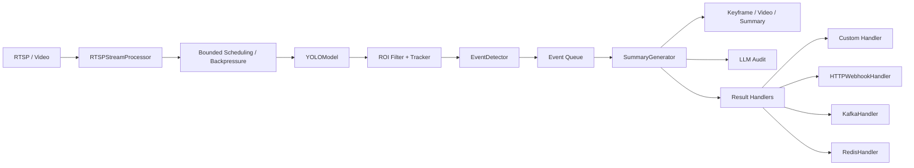

# Developer Guide

面向二次开发、扩展和性能调优。

## 系统架构



## 模块职责

- `highway_incident_detection/system.py`
  系统装配、生命周期管理、组件初始化、队列调度。

- `highway_incident_detection/stream/rtsp_stream.py`
  取流、重连、心跳、背压控制、在途帧上限控制。

- `highway_incident_detection/models/yolo_model.py`
  YOLO 推理封装、失败恢复、推理统计。

- `highway_incident_detection/detectors/event_detector.py`
  内置事件检测逻辑与注册式 detector 扩展入口。

- `highway_incident_detection/detectors/loader.py`
  从 `module:callable` 配置自动加载自定义 detector。

- `highway_incident_detection/summary/summary_generator.py`
  关键帧、事件视频、summary、audit record 生成，以及结果派发。

- `highway_incident_detection/output/`
  `EventResult`、内置 handler、对外结果输出协议。

- `highway_incident_detection/audit/event_auditor.py`
  大模型二次审计与本地风险回退策略。

## 自定义事件扩展

### 接口约定

自定义 detector 统一签名：

```python
def my_detector(detector, ctx: EventDetectionContext):
    ...
```

可用能力：

- `detector.is_in_cooldown(...)`
- `detector.update_event_time(...)`
- `detector.create_event(...)`

返回值可以是：

- `None`
- 单个 `IncidentEvent`
- `IncidentEvent` 列表

### 代码注册

```python
system.register_event_detector(
    name="smoke_alert_rule",
    event_type="smoke_alert",
    handler=my_detector,
    prepend=True,
)
```

### 配置自动加载

```yaml
event:
  custom_detectors:
    - name: "smoke_alert_rule"
      event_type: "smoke_alert"
      handler: "custom_detectors.smoke:smoke_alert_detector"
      enabled: true
      prepend: true
```

示例模块：
[custom_detectors/smoke.py](/Users/xiezhanlong/PycharmProjects/HighwayIncidentDetection/custom_detectors/smoke.py)

## 结果输出扩展

统一结果对象：

- `EventResult`

注册方式：

```python
system.register_result_handler(custom_handler)
```

内置 handler：

- `HTTPWebhookHandler`
- `KafkaHandler`
- `RedisHandler`

## 性能调优点

重点参数在 [config/config.yaml](/Users/xiezhanlong/PycharmProjects/HighwayIncidentDetection/config/config.yaml)：

- `stream.frame_skip`
  降低推理频率，直接影响吞吐。

- `stream.max_pending_frames`
  控制每路流最大在途帧数，值越大越能吸收短时抖动，但会增加积压风险。

- `stream.drop_frames_when_busy`
  在处理跟不上时是否直接丢帧。

- `yolo.img_size`
  影响精度与推理速度。

- `audit.enabled`
  审计会增加事件后处理时延。

## Benchmark

运行：

```bash
python benchmarks/pipeline_benchmark.py \
  --video data/parking.mp4 \
  --duration-seconds 10 \
  --frame-skips 1,2,4 \
  --max-pending-frames 1,2,4 \
  --processing-ms 20 \
  --handler-profiles none,sync,async,mixed \
  --handler-delay-ms 10 \
  --emit-every-n-frames 30 \
  --output-json output/benchmark/report.json
```

关注指标：

- `processed_frames`
- `dropped_frames`
- `effective_fps`
- `avg_callback_ms / p95_callback_ms`
- `avg_emit_ms / p95_emit_ms`

## 开发验证

```bash
pytest -q -o addopts=''
python -m compileall highway_incident_detection custom_detectors benchmarks tests example_usage.py main.py
```

## 关键目录

```text
highway_incident_detection/
custom_detectors/
benchmarks/
tests/
```
