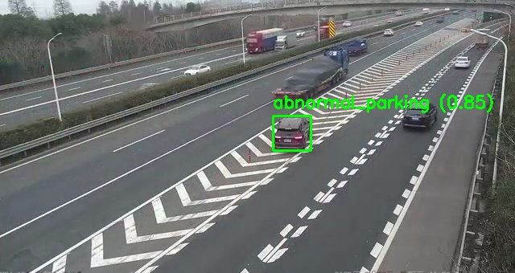
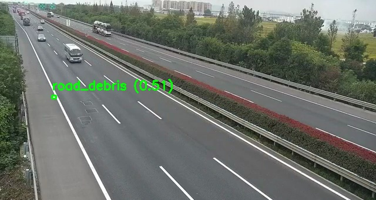

# Highway Incident Detection

> Detect highway incidents from RTSP streams or local videos, generate evidence packages, and optionally send every alert through an LLM audit pipeline.
>
> 基于 YOLO 的高速事件检测系统，支持 RTSP / 本地视频、多事件识别、证据落盘、结果外发，以及大模型二次复核。



## Why This Project | 项目亮点

**For GitHub readers**

- Built for real roadside monitoring workflows, not just offline object detection demos
- Handles multi-stream inference, event logic, evidence export, and downstream integrations in one codebase
- Supports lane-aware ROI zoning, per-stream event enable/disable, and custom detector extensions
- Can attach an LLM audit stage to reduce false positives before pushing results outward

**面向真实业务场景**

- 不只是“检测框”，而是完整的事件处理链路
- 支持多路视频流、事件规则、关键帧/视频/摘要输出、Webhook/Kafka/Redis 外发
- 支持按车道 ROI、按流控制事件类型、自定义 detector
- 可接入多模态大模型做事件复核，降低误报

## What It Detects | 支持事件

- `construction` / 施工
- `reverse_vehicle` / 逆行
- `motorcycle` / 摩托车
- `pedestrian` / 行人
- `road_debris` / 抛洒物
- `abnormal_parking` / 异常停车
- `congestion` / 拥堵

## Example Data | 示例数据

The repository ships with two local sample videos under [`data/`](data/).

仓库自带两段本地示例视频，可直接用于调试和演示。

| File | Preview | Scenario | Recommended focus |
| --- | --- | --- | --- |
| [`data/parking.mp4`](data/parking.mp4) |  | Highway split / merge scene with main lanes, opposite lanes, and a diverging ramp | ROI zoning, abnormal parking, per-stream event filtering |
| [`data/trash.mp4`](data/trash.mp4) |  | Highway scene suitable for road debris testing | Road debris detection, lane ROI tuning |

## Quick Start | 快速开始

### Install | 安装

```bash
pip install .
```

For development:

开发环境：

```bash
pip install -e ".[dev]"
```

If you need Kafka / Redis handlers:

如果要使用 Kafka / Redis handler：

```bash
pip install -e ".[integrations]"
```

### Run | 运行

```bash
highway-incident-detection --config config/config.yaml
```

or

```bash
python main.py --config config/config.yaml
```

For GPU multi-stream inference, start from [`config/gpu_batch_config.yaml`](config/gpu_batch_config.yaml):

GPU 多流场景建议直接从 [`config/gpu_batch_config.yaml`](config/gpu_batch_config.yaml) 起步：

```bash
highway-incident-detection --config config/gpu_batch_config.yaml
```

## What You Get | 输出内容

By default the system generates:

默认情况下，系统会生成：

- `output/keyframes/`
- `output/videos/`
- `output/summaries/`
- `output/audits/`

Each event can produce:

每个事件可产出：

- a keyframe image / 关键帧图片
- a video clip / 事件视频片段
- a summary JSON / 摘要 JSON
- optional audit output / 可选的大模型复核结果

## Core Capabilities | 核心能力

- Multi-stream processing with backpressure control
- YOLO single-frame and batch inference
- Lane ROI filtering with multi-zone support
- Per-stream event type filtering
- Unified `EventResult` output for downstream systems
- HTTP webhook / Kafka / Redis integrations
- Custom detectors loaded from `module:callable`
- LLM audit with global or per-event prompt overrides

- 多路流处理与背压控制
- YOLO 单帧 / 批量推理
- 支持多车道 ROI 分区
- 支持按流启用 / 禁用事件类型
- 统一 `EventResult` 输出协议
- HTTP Webhook / Kafka / Redis 外发
- 支持 `module:callable` 形式自定义事件
- 支持全局或按事件的 LLM 复核 prompt

## Configuration Patterns | 常用配置模式

Default config:

默认配置：

- [`config/config.yaml`](config/config.yaml)

GPU batch example:

GPU 微批配置示例：

- [`config/gpu_batch_config.yaml`](config/gpu_batch_config.yaml)

### Per-stream Event Control | 按流控制事件类型

```yaml
stream:
  streams:
    - name: "parking_cam"
      url: "data/parking.mp4"
      disabled_event_types: ["reverse_vehicle"]

    - name: "trash_cam"
      url: "data/trash.mp4"
      enabled_event_types: ["road_debris"]
```

- `enabled_event_types`: only run listed event detectors
- `disabled_event_types`: skip listed event detectors
- If both are present, allow-list is applied first, then deny-list

- `enabled_event_types`：只运行列出的事件
- `disabled_event_types`：跳过列出的事件
- 两者同时配置时，先应用白名单，再应用黑名单

### Multi-lane ROI Zones | 多车道 ROI 分区

```yaml
stream:
  streams:
    - name: "parking_cam"
      url: "data/parking.mp4"
      lane:
        enabled: true
        zones:
          - name: "main_right"
            roi_points: [[260, 339], [510, 339], [490, 168], [430, 170], [332, 238]]
            direction: "right"
          - name: "ramp_right"
            roi_points: [[510, 339], [639, 339], [639, 140], [575, 135], [490, 168]]
            direction: "right"
          - name: "far_left"
            roi_points: [[0, 192], [250, 192], [438, 154], [438, 126], [210, 132], [0, 150]]
            direction: "left"
```

- Each zone has its own ROI, direction, tracker state, and event state
- Output metadata includes `lane_zone`
- Old single-ROI config remains supported

- 每个 zone 都有独立的 ROI、方向、tracker 状态和事件状态
- 输出 metadata 会附带 `lane_zone`
- 旧的单 ROI 配法仍然兼容

### Minimal Runtime Config | 最小运行配置

```yaml
yolo:
  model_path: "yolov8n.pt"
  confidence_threshold: 0.5
  device: "cpu"

stream:
  frame_skip: 1
  max_pending_frames: 2

audit:
  enabled: false
```

## LLM Audit | 大模型复核

The audit layer can verify whether a detector hit is likely real before the result is pushed outward.

审计层可以在结果外发前，对检测命中做一次“是否真实事件”的复核。

Supported prompt customization:

支持的 prompt 自定义方式：

- `audit.system_prompt`
- `audit.user_prompt_template`
- `audit.system_prompt_path`
- `audit.user_prompt_path`
- `audit.event_prompt_overrides.<event_type>`

Example:

示例：

```yaml
audit:
  enabled: true
  endpoint: "https://api.openai.com/v1/chat/completions"
  api_key: "${OPENAI_API_KEY}"
  system_prompt: "You are reviewing highway incident detections. Return strict JSON."
  user_prompt_template: |
    Review this event:
    type={event_type}
    confidence={confidence:.2f}
    stream={stream_name}
    frame={frame_number}
    description={description}
    metadata={metadata_json}
```

## Integrations | 结果对接

### Custom Result Handler | 自定义结果处理

```python
from highway_incident_detection import EventResult, HighwayIncidentDetectionSystem


async def handle_result(result: EventResult) -> None:
    payload = result.to_dict()
    print(payload["event_type"], payload["processing_metrics"])


system = HighwayIncidentDetectionSystem(config_path="config/config.yaml")
system.register_result_handler(handle_result)
```

### Built-in Handlers | 内置处理器

```python
from highway_incident_detection import (
    HTTPWebhookHandler,
    KafkaHandler,
    RedisHandler,
)

system.register_result_handler(
    HTTPWebhookHandler("http://127.0.0.1:8080/webhook")
)
system.register_result_handler(
    KafkaHandler(topic="incident-events", bootstrap_servers="127.0.0.1:9092")
)
system.register_result_handler(
    RedisHandler(url="redis://127.0.0.1:6379/0", channel="incident-events")
)
```

## Custom Detectors | 自定义事件扩展

### Code Registration | 代码注册

```python
from highway_incident_detection import EventDetectionContext, HighwayIncidentDetectionSystem


def smoke_alert_detector(detector, ctx: EventDetectionContext):
    if detector.is_in_cooldown(ctx.stream_name, "smoke_alert", ctx.timestamp):
        return None

    detector.update_event_time(ctx.stream_name, "smoke_alert", ctx.timestamp)
    return detector.create_event(
        event_type="smoke_alert",
        stream_name=ctx.stream_name,
        timestamp=ctx.timestamp,
        frame_number=ctx.frame_number,
        confidence=0.9,
        description="Custom smoke alert",
    )


system = HighwayIncidentDetectionSystem(config_path="config/config.yaml")
system.register_event_detector(
    name="smoke_alert_rule",
    event_type="smoke_alert",
    handler=smoke_alert_detector,
)
```

### Auto-load from Config | 配置自动加载

Example module:

示例模块：

- [`custom_detectors/smoke.py`](custom_detectors/smoke.py)

```yaml
event:
  custom_detectors:
    - name: "smoke_alert_rule"
      event_type: "smoke_alert"
      handler: "custom_detectors.smoke:smoke_alert_detector"
      enabled: true
      prepend: true
```

## Developer Notes | 开发者说明

- Architecture and module responsibilities: [`DEVELOPER.md`](DEVELOPER.md)
- Installation details: [`INSTALLATION.md`](INSTALLATION.md)
- Packaging notes: [`PACKAGING.md`](PACKAGING.md)

## License

MIT
